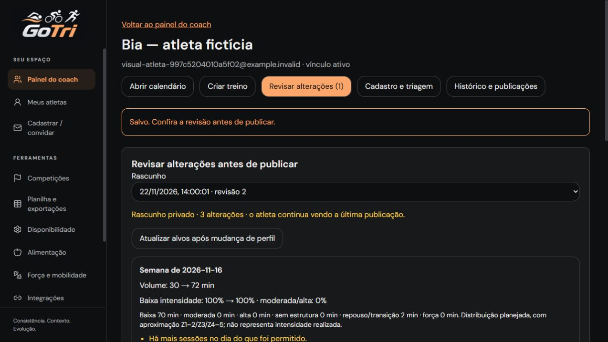

# Área do Coach e aplicação da logo — 22/11/2026

Implementação incremental sobre `d10896d`, na branch `codex/area-coach`. O app continua no projeto R10tri. A logo GoTri fornecida pelo usuário foi adaptada para laranja/prata sobre grafite e aplicada ao login e à navegação, sem renomear repositório ou contas.

## Diagnóstico e mudanças

| Problema anterior | Causa | Solução |
|---|---|---|
| Coach consultava qualquer atleta | Papel global usado como autorização suficiente | Vínculo ativo explícito, verificado pelo servidor em consultas e operações |
| Exclusão de aluno apagava histórico | Exclusão da conta com cascata | Encerramento do vínculo; conta, prescrições, logs e publicações permanecem |
| Conta existente não tinha aceite de assessoria | Convite de senha confundido com vínculo | Convite interno pendente, aceito ou recusado exclusivamente pelo atleta |
| Ajustes apareciam imediatamente no calendário | Treinos publicados eram editados diretamente | Rascunho separado, revisão e publicação transacional |
| Nova geração podia substituir ajustes do coach | Ausência de autoria e controle de versões | Marca de prescrição do coach, proposta separada e verificação de versões antes de publicar |
| Conclusão concorrente podia registrar prescrição alterada | Leitura e gravação sem comparação da versão | Conclusão condicionada à versão lida; conflito retorna 409 antes de gravar log/peso |
| Transições curtas e blocos manuais apareciam sem estrutura | Leitor exigia o formato completo do gerador para qualquer prescrição | Origem manual explícita, validando cada passo e sua soma; gerador conserva seus requisitos |
| Partes do brick não tinham ordem persistida | Ordenação apenas por data | Grupo e ordem explícitos para bike, transição e corrida |
| Data de sugestão gerada não seguia o contrato do editor | Data completa com horário versus dia de calendário | Normalização na entrada do rascunho, coberta por edição e publicação de bloco |

## Uso

1. Entre com uma conta cujo papel `coach` já foi autorizado no servidor. A seleção visual “Coach” não muda permissões. O acesso passa pela entrada do servidor e abre `/coach`; atletas seguem para sua área.
2. Em **Cadastrar / convidar**, informe nome e e-mail. Para conta existente, o convite aparece na área do atleta. Até o aceite não há acesso aos dados esportivos. Para conta nova, o coach recebe um link privado de primeiro acesso, válido por 48 horas, para compartilhar com o aluno. A senha é definida pelo próprio atleta; o banco armazena somente o hash do token. Renovação de primeiro acesso só é permitida ao coach com vínculo ativo e enquanto a conta não tiver senha.
3. Abra a ficha. As ações prioritárias são **Abrir calendário**, **Criar treino** e **Revisar alterações**. Cadastro/triagem reúne limites, equipamentos, FTP/limiares, objetivos/provas e disponibilidade diária. Dados esportivos e provas alterados pelo coach têm auditoria.
4. Crie uma sessão, duplique uma existente ou gere uma proposta de uma semana/bloco. Edite os blocos, repetições, duração em segundos, distância auxiliar, zona, recuperação e observações. Em bike, faixas percentuais de FTP são convertidas no servidor; percentuais fora da zona escolhida são recusados para não falsear a distribuição. Sem FTP/equipamento compatível, use zona/PSE.
5. O brick salva três partes editáveis, agrupadas e ordenadas: bike, transição passiva e corrida. Transição é tempo de agenda e repouso, fora do denominador de endurance e da contagem de sessões esportivas. Distância é auxiliar; informe também duração prevista. O calendário usa minutos arredondados para cima, e os blocos conservam segundos exatos.
6. Selecione sessões futuras de uma semana ou intervalo para mover, reduzir duração ou propor cancelamento. O editor também permite substituir a modalidade e ajustar a sugestão antes de publicar. Cancelamento é uma pausa reversível no modelo; nenhuma conta ou sessão realizada é apagada.
7. Na revisão, compare volume anterior/proposto, baixa/moderada/alta intensidade, minutos sem estrutura e conflitos de disponibilidade/recuperação. O coach decide; o sistema não comprime faltas nem promete prontidão clínica. Salve as orientações no rascunho se ainda não for publicar.
8. Confirme a revisão para publicar. O atleta continua vendo o calendário anterior enquanto a proposta está em rascunho. Após publicação, recebe um aviso e pode consultar autor, data, sessões alteradas e orientações. Orientações avulsas continuam disponíveis dentro do app, com abertura opcional do WhatsApp para envio manual.
9. Ao encerrar o vínculo, o acesso do coach é retirado. O aluno conserva seus treinos e o histórico de publicações.

**Contas anteriores:** nenhum vínculo foi inferido a partir do papel global de coach. O painel inicialmente pode estar vazio. Convide os alunos existentes e peça que aceitem na própria área. Isso evita atribuir automaticamente todos os atletas a um treinador.

## Garantias de autorização e publicação

- `auth.ts` já consulta o papel/versão da conta no banco ao validar a sessão. Cadastro público não provisiona coaches. A mudança de destino após login usa uma página do servidor.
- `lib/coach-access.ts` concentra o escopo e a exigência de vínculo. Novas gravações usam transações serializáveis e atualizam a linha do vínculo, coordenando publicação e encerramento concorrentes.
- O coach acessa somente fichas com vínculo ativo próprio. Alterar IDs de aluno, sessão, rascunho, prova ou publicação não transfere autorização. O atleta consulta somente seus próprios convites/publicações e dados.
- APIs antigas de treino/plano não permitem ao coach modificar diretamente o calendário de outro usuário. Exportações, mensagens e alertas também respeitam o vínculo. Rascunhos nunca são tabelas de calendário nem entram em exportações/listas do atleta.
- `CoachDraft.revision` impede sobrescrever edição concorrente. Cada alteração de sessão registra a versão original; uma sessão concluída/editada depois do rascunho bloqueia a publicação. Publicação por rascunho é única e atômica.
- Alteração de perfil/FTP/disponibilidade invalida a confirmação anterior. **Atualizar alvos** recompila a proposta com os dados atuais; conflitos de sessão exigem retirar a alteração pendente e reabrir a versão publicada. Atualizar preferências não reescreve silenciosamente o plano.
- Prescrições futuras já publicadas pelo coach ficam fora do recálculo automático de FTP do perfil. Gere/revise uma proposta para publicá-las com os novos alvos. Sessões realizadas continuam preservadas.
- Publicações e auditorias registram autoria, data e mudanças. Perfis serializados para a ficha/auditoria não incluem chaves de integração. Links de primeiro acesso não devem ser compartilhados publicamente.

## Módulos e banco

- Banco: `CoachAthlete`, `CoachDraft`, `CoachPublication`, `CoachAudit`; autoria/grupo/ordem no treino. Migrações `20261121010000_area_coach` e `20261122010000_ordem_bricks`, ambas aditivas.
- Domínio: `lib/coach-access.ts`, `lib/coach-editor.ts`, `lib/coach-service.ts`; leitor de estrutura, revisão semanal e atualização de FTP.
- Interface: páginas `/coach`, `/coach/atletas/[id]`, entrada por papel; `coach-hub`, `coach-athlete-editor`, `coach-inbox`, navegação e marca. URLs antigas de atletas redirecionam para a nova área protegida.
- API: `/api/coach/athletes`, `athlete`, `invite`, `invitations`, `respond`, `end`, `profile`, `race`, `message`, `session`, `batch`, `generate`, `notes`, `rebase`, `publish`, `publications`. Operações de aluno usam a sessão; não existe parâmetro que conceda um papel.
- Testes: `tests/coach-editor.test.ts`, regressões de segurança/exportação/geração e `scripts/coach-smoke.mjs`. O CI executa `npm run test:coach` em PostgreSQL isolado.

## Validação e limites

Os testes do coach usam duas contas fictícias de coach, duas contas fictícias de atleta e um cadastro novo, exclusivamente em `r10tri_test`/`r10tri_ci` no PostgreSQL local. Cobrem login/papel, redirecionamento, convite/aceite, ausência de duplicação, URL direta, acesso cruzado, ficha sem segredo, auditoria, prova, brick/FTP, rascunho invisível, publicação, conflito após perfil/FTP, preservação de realizado, duplicação, cancelamento, proposta do gerador, edição de sugestão, versões concorrentes, notas salvas e revogação do vínculo. O resumo final e os resultados do CI acompanham a entrega.

O teste unitário antigo que pressupunha gestão global foi atualizado para exigir a nova regra. Emissão/renovação de convites passou a ser verificada também no fluxo real com PostgreSQL, incluindo token persistido com hash. Não foram relaxados os requisitos de permissão para manter testes antigos verdes.

Limites: convite de vínculo é entregue dentro do app; não depende de envio de e-mail, que continua condicionado ao provedor/remetente configurados. Não há validação física de Safari/iPhone nesta entrega. 80/20 é distribuição planejada por tempo e aproximação das zonas exibidas; não se inventam amostras de intensidade realizada. Ajustes são explícitos e a aprovação dos conflitos pertence ao coach. Rascunhos/publicações podem ser consultados com a sessão autorizada; não há link público para ficha de aluno.

## Logo

Origem: [logo GoTri fornecida pelo usuário](https://chatgpt.com/s/p_eeb3078d5e508191a7b44d7de8076cfe). Arquivo aplicado: `public/brand/gotri-laranja.png`. Cores de referência: laranja `#FBA66A`, prata/branco `#F0F0F0`, grafite `#101113`. A imagem é servida pelo componente compartilhado de marca, com otimização de tamanho do Next.js. Não foram alterados o nome técnico do projeto, contas ou domínios.

## Resultado da conferência — 22/11/2026

- 172 testes automatizados aprovados, 20 cenários HTTP novos do coach aprovados e 30 cenários anteriores de integração aprovados em PostgreSQL isolado. Autenticação HTTP 10/10; o CI também repete recuperação por SMTP TLS local.
- Compilação de produção, tipos e linter sem avisos aprovados. Auditoria de dependências e verificação de padrões de credenciais sem ocorrências.
- Login de uma conta fictícia de coach na seleção visual padrão de atleta redirecionou para o painel exclusivo, confirmando que o destino depende do papel no servidor.
- Conferência visual: rascunho de brick mantido privado; após recompilar os alvos, a revisão mostrou 70 min em baixa, 2 min de transição e 0 min sem estrutura. O excesso de sessões do exemplo permaneceu sinalizado para decisão do coach.
- Editor conferido em 320, 390, 768 e 1280 px; largura da página inferior à largura disponível em todos os casos. Não representa teste físico de dispositivos ou certificação Safari.

