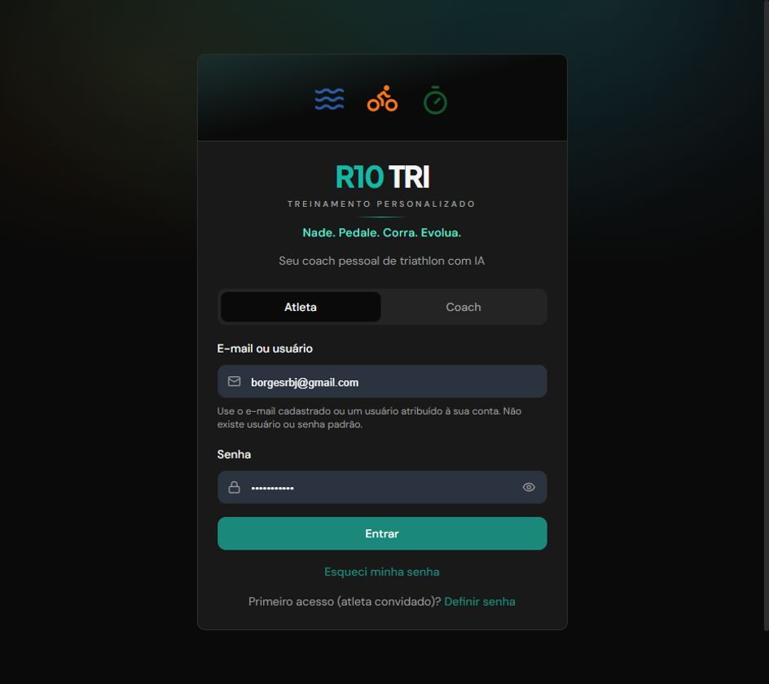
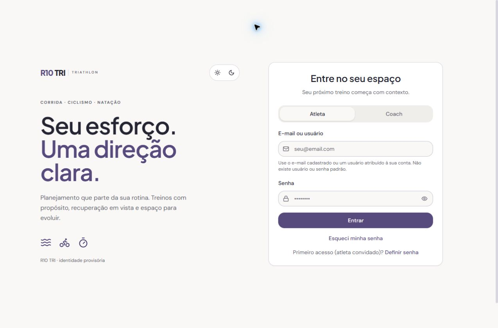
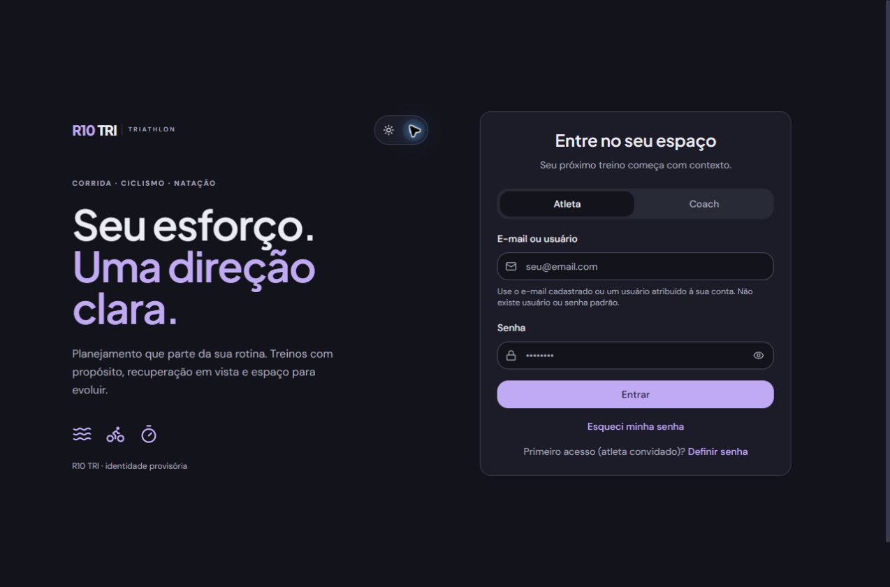
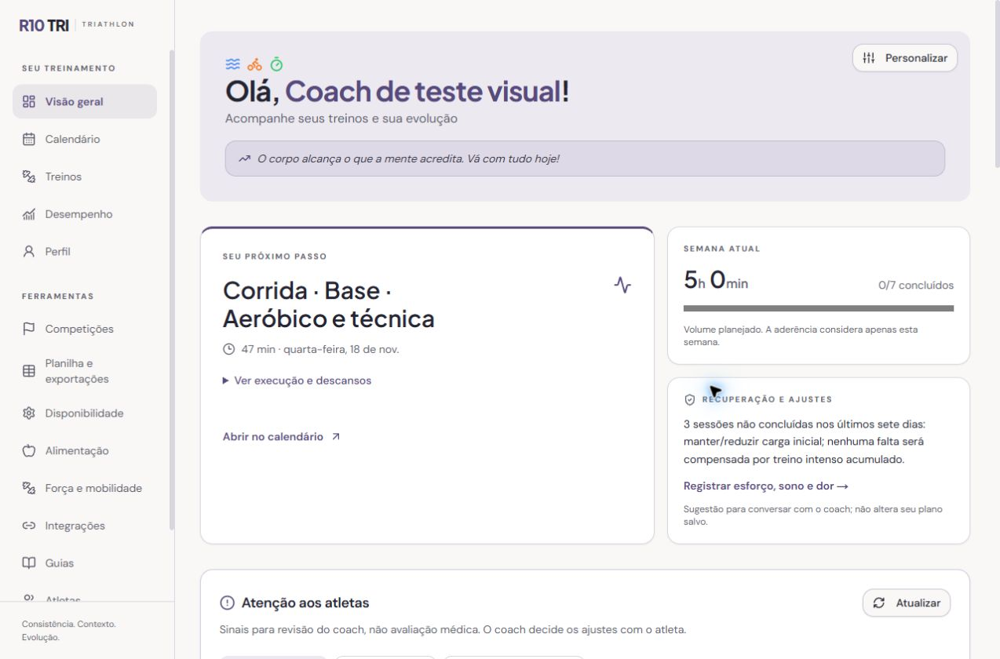
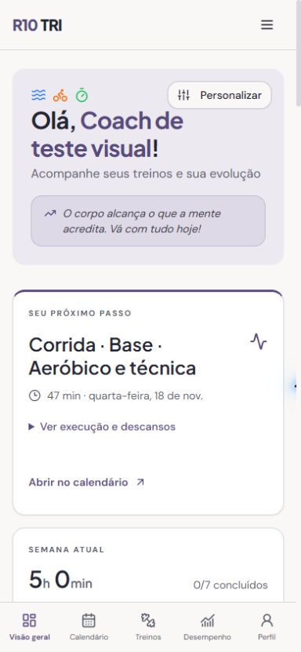
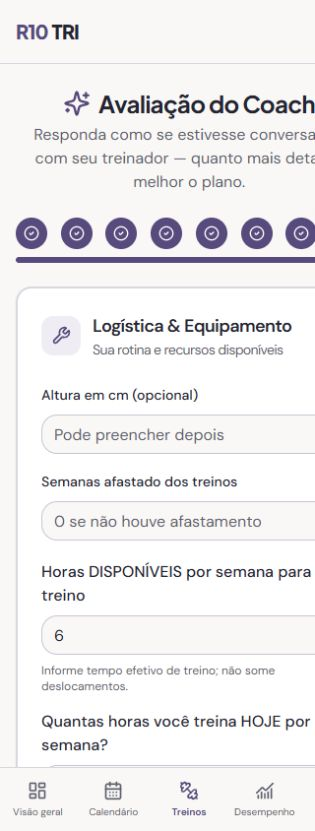

# Identidade provisória e sistema visual — 16/11/2026

Gotri é o nome escolhido pelo usuário em 22/11/2026. Os nomes sugeridos anteriormente permanecem como referência histórica; nenhum registro de marca foi realizado. O redesign reaproveita componentes, rotas e dados existentes; não simula uma plataforma nova.

## Três direções avaliadas

| Direção | Paleta e composição | Clareza e personalidade | Decisão |
|---|---|---|---|
| Mineral | Lilás profundo `#574A7D`, lilás suave `#ECE9F1`, damasco `#F6DCC8`, papel `#F9F8F6`, carvão `#242432`. Superfícies planas, linha fina, números destacados. | Calma, legível e multiesportiva; o destaque quente não compete com estados de dor/alerta. | **Escolhida**, respeita a preferência por lilás e laranja pastel. |
| Horizonte | Azul `#214D64`, névoa `#E8F0F1`, areia `#F4D4A8`, fundo `#F7FAFA`, texto `#18303C`. Agenda mais técnica e densa. | Boa leitura e relação com água/endurance; personalidade menos próxima da preferência do usuário. | Alternativa, não aplicada. |
| Pulso editorial | Ameixa `#503E57`, rosa `#F0E5EA`, coral `#F0B09A`, marfim `#FCF8F2`, texto `#302733`. Grandes títulos e ritmo editorial. | Distinta, mas títulos e espaços maiores reduzem densidade útil do calendário. | Alternativa, não aplicada. |

As alternativas são conceitos comparáveis, não três interfaces publicadas. A implementação usa tokens HSL em `app/globals.css`; hexadecimais acima são aproximações de apresentação. A aparência final é verificável no código e nas capturas entregues.

## Tokens implementados

| Papel | Claro, HSL | Escuro, HSL |
|---|---|---|
| Fundo / texto | `40 23% 97%` / `240 16% 17%` | `235 18% 9%` / `260 24% 94%` |
| Superfície | `0 0% 100%` | `235 17% 13%` |
| Ação / texto da ação | `256 26% 39%` / branco | `258 75% 81%` / `252 35% 18%` |
| Secundária | `260 24% 93%` | `247 19% 20%` |
| Destaque / texto | `25 72% 88%` / `22 48% 24%` | `25 34% 23%` / `25 80% 81%` |
| Texto de apoio | `240 8% 40%` | `245 13% 70%` |
| Erro / texto | `0 65% 40%` / branco | `0 72% 73%` / `0 44% 13%` |
| Borda / foco | `250 13% 86%` / ação | `240 14% 26%` / ação |

Cor nunca é o único indicador: modalidade tem nome/ícone; conclusão tem texto; alertas explicam o motivo. Gráficos preservados precisam de legenda, unidades e contexto. Uma cor esportiva não deve transmitir diagnóstico de recuperação.

## Componentes e hierarquia

- **Tipografia:** fontes existentes e alternativas locais do projeto. Títulos com `font-display`, corpo legível, números com unidade. Título de página 24–30 px; login 30–60 px conforme largura; corpo 14–16 px; rótulos e apoio nunca substituem o título do campo. Inputs móveis com 16 px para reduzir zoom inesperado no iOS.
- **Espaçamento:** escala de 4 px, blocos com 16/24/32 px; conteúdo ocupa a largura útil após a barra lateral de 224 px. Cartões têm raio de 16 px e borda discreta. O próximo treino recebe uma linha superior, sem gradiente decorativo.
- **Botões:** ação primária preenchida, secundária contornada, destrutiva semântica, carregamento com `aria-busy` e bloqueio de envio duplicado. Estados de hover, foco visível e desabilitado preservados. Controles de toque têm altura mínima de 44 px quando o dispositivo informa ponteiro de toque.
- **Formulários:** etapas da triagem preservadas, limites diários condicionados aos dias escolhidos, valores desconhecidos opcionais, mensagens com causa e próximo passo. Prioridade A/B/C na prova; nenhuma senha padrão na tela de acesso.
- **Ícones:** Lucide já utilizado pelo projeto, com rótulo acessível em controles sem texto. Modalidade e mensagem não dependem apenas do desenho.
- **Estrutura da sessão:** objetivo, fase, duração, blocos, alvo e percepção; detalhes expansíveis evitam repetir toda a prescrição no painel. Intervalos passivos aparecem separados da intensidade ativa.
- **Tema:** botões explícitos de modo claro/escuro, preferência persistida pelo provedor existente; não há tema escuro obrigatório. Animação esportiva decorativa removida da apresentação, sem apagar funcionalidade.
- **Estados:** painel sem próximo treino oferece acesso ao planejamento; falha na leitura do feedback é mostrada; nenhum indicador é preenchido com dados demonstrativos na produção.

## Navegação e responsividade

Computador: barra lateral com Visão geral, Calendário, Treinos, Desempenho e Perfil. Provas, disponibilidade, planilha, guias, exercícios, nutrição, integrações e gestão de atletas continuam no menu secundário. Celular: cinco destinos na barra inferior e menu superior para ferramentas. Há link de pular para o conteúdo, `aria-current`, fechamento com Escape e respeito às áreas seguras do iPhone. A barra inferior não deve cobrir o último botão; conteúdo e utilitário PWA reservam espaço.

Login apresenta propósito e formulário em duas colunas no computador; no celular o texto é reduzido para priorizar o acesso. As telas antigas herdam tokens e navegação, preservando controles e dados. A agenda mostra listas filtradas por dia, semana ou mês; não anuncia uma grade mensal com arrastar e soltar.

## Evidências e limites

Capturas antes/depois ficam na entrega local `outputs/evidencias/auditoria`. A tela anterior foi capturada da publicação existente; as posteriores usam conta fictícia no PostgreSQL isolado. As larguras e verificações efetivamente executadas constam de `VALIDACAO_2026.md`. Redimensionar Chrome não equivale a testar Safari/iPhone físico. A revisão visual não é certificação integral WCAG: leitura por leitor de tela, contraste de todos os gráficos legados e uso com tecnologias assistivas exigem uma rodada dedicada.

## Comparação visual

### Acesso anterior

### Acesso revisado

### Painel e celular

[Medições de largura, contraste e navegação](evidencias/verificacao-navegador.json). O registro conserva o excesso inicial de largura e a revalidação após a correção, em vez de ocultar o achado.
